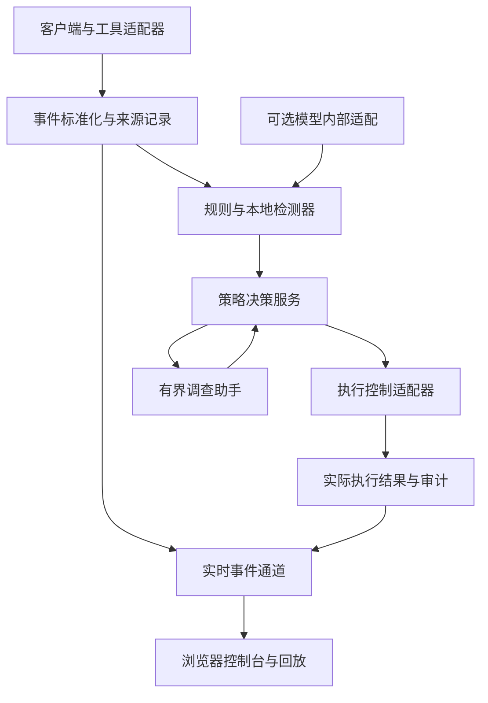

# Agent 安全卫士：产品定义、工程方案与 Codex 完整交接书

版本：v1.0  
编制日期：2026-10-29（北京时间）  
文档用途：提供给没有任何前序聊天背景的 Codex，作为产品规划、技术验证、实现和验收的起点。  
产品名称：尚未确定；本文“Agent 安全卫士”为工作称呼，不代表最终品牌。  
文档状态：产品方向已确认；技术方案为建议；依赖项目仅完成前期文档调研，尚未安装实测。

> 接手者首先阅读第 1—4 节与第 25 节。不要把本文理解为已有实现，也不要把候选依赖写成已验证能力。用户要的是可长期使用、真实有效、视觉出色的开源产品，不是静态网页、论文原型或只有模型权重的仓库。

## 目录

1. 项目背景与用户动机
2. 用户已经确认的决定
3. 产品定位与目标用户
4. 目标、非目标与成功标准
5. 威胁模型与防护边界
6. 接入方式与能力矩阵
7. 核心用户旅程
8. 功能需求与优先级
9. 检测与处置设计
10. 安全调查 agent 的职责
11. 内部模型信号增强
12. 总体架构与建议技术栈
13. 事件模型、插件契约与接口草案
14. Windows 首发与客户端适配
15. 控制台信息架构
16. 视觉、粒子动效与交互规范
17. 短视频演示与事件回放
18. 性能、稳定性与故障行为
19. 隐私、权限与产品自身安全
20. 参考项目、复用策略与调研清单
21. 测试、评测与验收矩阵
22. 分阶段实施路线
23. 开源、品牌与传播
24. 风险登记、待决事项与默认判断
25. 给接手 Codex 的启动指令
26. 文档与仓库交付清单
27. 官方来源与证据说明

## 1. 项目背景与用户动机

### 1.1 为什么做

用户判断：未来会有越来越多的人拥有自己的 AI agent，让它读文件、查网页、调用工具、运行代码、处理日常任务。随着这些能力进入个人电脑，安全问题会越来越重要，个人 agent 安全可能形成有价值的市场。

这是用户的创业式产品判断，尚不是已经验证的市场规模结论。产品需要通过安装用户、真实场景和使用反馈逐步验证。

用户希望在 GitHub 开源一个真正好用的项目，获得关注、星标、贡献者和使用者，使其成为个人长期代表作，帮助后续学习、科研交流和职业发展。项目以开源工程和产品价值为主，不以发表学术论文作为首要目标。

用户对 LLM 安全、拒绝机制、激活方向、梯度信号与微调已有学习积累。希望将这些知识转化为实际防御能力，尤其希望未来利用模型内部可用信号辅助风险检测。但这些信号必须有适用边界、可验证价值和成本测量，不能只作为营销概念。

### 1.2 用户希望做什么

不是发布一个单独的“安全 LLM”，而是发布可以安装、接入现有 AI、持续运行的安全软件。该软件可以使用现成模型、已有检测器、开源运行时框架和后续自训探针。模型是内部组件，最终交付是完整产品。

用户明确赞成借鉴、复用已有项目，不要求全部自研。产品的独立价值来自统一接入、风险理解、可靠执行控制、直观解释、持续维护及出色体验。

### 1.3 视觉是核心需求

用户计划先通过短视频展示项目，因此产品必须“非常炫酷”。明确提出：实时事件流、实时动效、来自多个接入点的信息流，以及有害或可疑信息被抽离、聚合的粒子效果。

视觉不是附加装饰，而是首版产品要求。与此同时，用户明确认为：防护无效或性能不好，再漂亮也没有意义。实现必须把真实能力和视觉同时推进。

## 2. 用户已经确认的决定

以下为已确认内容，不需要再次从头询问。

| 编号 | 事项 | 已确认决定 | 实现含义 |
|---|---|---|---|
| D01 | 产品性质 | 面向实际使用的开源安全产品 | 不要把任务改写成纯论文研究 |
| D02 | 初期用户 | 用户自己，及类似的个人 agent 使用者 | 优先能在用户日常工作中使用 |
| D03 | 首批目标客户端 | 用户经常使用的 Claude、Codex 一类 agent | 先确认具体客户端形态与版本，不假设所有产品共用接口 |
| D04 | 首发平台 | Windows | 必须最终在 Windows 验证，随后扩展其他平台 |
| D05 | 第一版外观 | 本地后台服务＋浏览器控制台 | 桌面外壳后续再增加 |
| D06 | 检测位置 | 默认本地检测 | 云端分析不能成为默认隐式依赖 |
| D07 | 视觉风格 | “帅就完了”，细节以后调整 | 可先自主采用精致科幻风，保持易读 |
| D08 | 动效 | 实时事件流、多个接入点、粒子抽离与聚合 | 必须与实际事件状态建立对应 |
| D09 | 开发节奏 | 不着急，重视质量 | 不强行规定一周发布，不以赶工牺牲可靠性 |
| D10 | 复用 | 积极借鉴与复用已有项目 | 先验证接口、维护状态、许可和资源成本 |
| D11 | 内部监测 | 希望成为可选增强能力 | 不让内部适配阻塞基础产品使用 |
| D12 | 传播目标 | 短视频＋GitHub，形成个人代表作 | 需要可复现演示、漂亮首页和简单安装路径 |

“Claude、Codex”目前是产品家族级表达，并不等于已经确认 Claude Code CLI、Codex CLI、桌面端、IDE 插件或网页版中的哪一个。接手 Codex 可先查看用户本机实际安装和版本，再提出最小必要问题。这属于接入事实确认，不是重新讨论产品定位。

## 3. 产品定位与目标用户

### 3.1 一句话定位

一个优先本地运行的开源 agent 安全卫士，帮助用户看清 AI 正在读取什么、准备执行什么、将数据发往哪里，并在支持的执行边界进行告警、暂停或阻断。

### 3.2 用户价值

| 保护对象 | 用户问题 | 提供的价值 |
|---|---|---|
| 私人数据 | 我的密钥、文件、对话会不会被发走？ | 敏感信息与外传风险检查 |
| 操作权限 | agent 会不会删除、发送、执行我没授权的东西？ | 执行前审查与权限约束 |
| 真实任务 | 它会不会被网页、仓库或工具返回内容骗走？ | 来源识别、注入检测、任务偏离审查 |
| 可理解性 | 为什么拦截？实际保护了哪里？ | 证据解释、覆盖状态与事件回放 |

对外主叙事：保护“你的 agent、数据和操作”，而非默认审查用户所有对话。内容安全分类作为可选能力，不把有害文本与危险行为混为一谈。

### 3.3 用户扩展路径

1. 用户本人及个人开发者：AI 编程、MCP、文件与命令行操作。
2. 进阶个人助理用户：文件管理、浏览网页、自动化工作流。
3. 普通用户：需要更简单安装和桌面体验。
4. 小团队与多 agent 场景：后续可能探索，不挤占首版范围。

## 4. 目标、非目标与成功标准

### 4.1 长期目标

- 一套控制台管理多个受支持的 agent 接入。
- 默认本地、隐私透明、可选择增强模块。
- 同时覆盖交互内容、工具行为与可选的模型内部信号。
- 让安全事件可见、可解释、可操作、可回放。
- 提供稳定插件接口，允许社区贡献适配器、规则和探针。
- 成为有独立品牌、持续版本更新和真实用户的开源项目。

### 4.2 首个完整版本目标

- 在 Windows 上安装并运行后台及浏览器控制台。
- 至少对一个实际使用的目标客户端跑通真实集成；优先评估 Claude Code 和 Codex 的实际版本能力。
- 提供真实执行前检查路径，不能用事后日志假装拦截。
- 支持观察模式和保护模式。
- 覆盖外部提示注入、敏感信息外传、危险工具调用三个核心场景。
- 提供实时事件流、粒子防护场景、详情与处置、状态和资源显示。
- 有独立标注的安全演示模式及可重复验收。
- 默认无需云端检测服务；首次模型下载需明确说明。

### 4.3 首版不承担

- 通用操作系统杀毒、内核级 EDR、所有网络流量防护。
- 自动覆盖整台电脑所有 AI 应用。
- 对闭源远程模型读取真实隐藏状态。
- 所有模型、量化方式、推理引擎的通用探针。
- 通用事实核验、全领域内容审查、完整传统 SOC。
- 默认读取所有个人文件、浏览器历史或账号数据。
- 初期同时建设复杂企业多租户、计费与云端控制平面。
- 在没有授权时发布 GitHub 仓库、上传日志或公开部署控制台。

### 4.4 成功标准

安全：在规定的接入路径和测试场景中，危险副作用被真正阻止。  
可用：正常任务能继续完成，误拦截可定位、可纠正。  
性能：延迟、资源、并发和长时间运行都有测量结果。  
体验：新用户看得懂接入状态，能完成第一次防护体验。  
视觉：动态场景与真实事件一致，低配置可降级。  
开源：外部用户能按照 README 复现演示并运行项目。

## 5. 威胁模型与防护边界

### 5.1 假设的攻击入口

- 网页、文档、仓库文件、邮件类材料中的间接提示注入。
- MCP 工具描述、工具返回结果或 skill 中的恶意指令。
- 利用模糊授权诱导额外发送、上传、执行、删除。
- 在多步工具调用中逐渐偏离原任务。
- 诱导 agent 读取敏感文件后通过外部目标发送。

### 5.2 资产与信任层次

- 用户明确任务与真实授权：由受信任接入层记录。
- 外部内容：默认为数据，不自动获得指令权威。
- 工具参数及结果：需保留来源和执行阶段。
- 检测模型输出：是证据，不具有自动修改安全策略的权力。
- 策略与审批：由用户及独立控制服务管理。
- 来源标签：由接入层生成，不能接受材料自称“系统指令”作为权威。

### 5.3 关键边界

防护只对经过其控制点的行为生效。MCP 网关不自动覆盖本地原生 shell；模型代理不自动控制客户端文件操作；日志订阅不等于执行前保护。

即便可以拦截某一次命令，若 agent 仍可通过别的工具、子进程或网络路径达到同样目的，也不能宣称完整阻断。首版需记录这些覆盖缺口；强隔离属于后续分层能力。

本机已被管理员级恶意软件完全控制不属于首版能解决的威胁。操作系统权限、沙箱和网络限制可以形成更强边界，但必须单独实现与测试。

## 6. 接入方式与能力矩阵

| 接入类型 | 可见信息 | 可控制行为 | 能力限制 |
|---|---|---|---|
| 模型交互代理 | 请求、响应及可解析上下文 | 发出请求前、交付输出前检查 | 不能阻止未经过代理的工具副作用 |
| 执行前钩子 | 工具名、参数、部分任务上下文 | 放行、暂停、拒绝对应调用 | 依赖客户端确实等待并遵守结果 |
| MCP 网关 | 经过网关的 MCP 调用与结果 | 调用前检查、返回内容扫描 | 不覆盖其他非 MCP 工具 |
| 网络出口控制 | 经代理的连接与可解析内容 | 地址约束、外传拦截 | 加密内容解析与代理绕过需单独处理 |
| 推理运行时适配 | 特定模型激活、探针结果 | 升级审查、停止后续生成 | 不能回收已输出 token 或已执行动作 |
| 事后日志 | 已发生的行为 | 告警、调查、回放 | 不能标记成执行前保护 |

每个适配器必须声明能力，不按“本地／远程”粗略决定等级。推荐能力字段：can_observe_input、can_observe_output、can_observe_tool_result、can_block_before_tool、can_pause、can_cancel_generation、can_read_activations、observation_phase。

控制台必须区分“已连接”“可观察”“可阻断”“已降级”。连接成功不是保护完整的证据。

## 7. 核心用户旅程

### 7.1 初次安装

下载安装或克隆仓库 → 启动本地服务 → 浏览器打开控制台 → 选择客户端 → 检查版本和支持能力 → 用户确认配置修改 → 备份旧配置 → 完成接入 → 执行无害自检 → 显示保护能力卡。

不要在没有确认时覆盖现有模型提供商、代理、MCP 或工具配置。提供差异预览和恢复入口。端口冲突、模型缺失、WSL 路径等问题应有可操作提示。

### 7.2 日常使用

用户照常使用原有 agent。安全服务后台工作；面板无需一直开启。主界面显示最近事件、检测状态、待处理风险与真实覆盖范围。

### 7.3 风险事件

接入层提交待执行动作 → 规则与检测器检查 → 策略决定 → 执行器落实 → 回传实际结果 → 界面动画和日志更新。

示例提示：

> 已暂停一次上传操作。当前任务是整理本地实验记录，但待执行动作准备向未授权地址发送文件。相关上传要求出现在外部文档中。你可以查看证据、取消操作或仅允许本次动作。

如果缺少足够上下文，只能说明“目标未在当前允许范围中”，不能凭空声称“由文档注入导致”。

### 7.4 误报处理

允许查看原始证据的脱敏版本 → 标记误报 → 可选择单次放行 → 规则例外另行明确创建。标记误报不应静默永久放行类似操作。

### 7.5 停止与恢复

支持停止后续受控调用、取消受支持的生成、断开某个接入。按钮必须说明作用范围。不要把关闭面板当作关闭保护，也不要声称能撤销已经完成的外部副作用。

## 8. 功能需求与优先级

P0 为首个可用版本必须；P1 为首版打磨或下一阶段；P2 为后续扩展。

| ID | 优先级 | 功能 | 验收概述 |
|---|---|---|---|
| FR01 | P0 | 接入管理 | 展示客户端、版本、连接与能力 |
| FR02 | P0 | 真实执行前检查 | 至少一个客户端等待决策后才执行 |
| FR03 | P0 | 三类核心风险检查 | 注入、外传、危险工具行为有具体测试 |
| FR04 | P0 | 观察／保护模式 | 相同检测结果在不同模式下处置不同 |
| FR05 | P0 | 统一实时事件流 | 有事件 ID、状态、来源及详情 |
| FR06 | P0 | 粒子主视觉 | 与真实事件和处置状态关联 |
| FR07 | P0 | 人工处置 | 取消、单次放行、查看证据 |
| FR08 | P0 | 保护覆盖与降级 | 检测器故障和适配限制可见 |
| FR09 | P0 | 默认本地检测 | 不隐式把内容发送至第三方 |
| FR10 | P0 | 启停、诊断与配置备份 | Windows 用户可复现运行和恢复 |
| FR11 | P0 | 安全演示模式 | 使用模拟工具、明确标识、不混入真实统计 |
| FR12 | P0 | 基础历史记录 | 查询事件与处置，可清理 |
| FR13 | P1 | 调查助手 | 有界读取相关事件并汇总证据 |
| FR14 | P1 | 事件回放与录屏布局 | 暂停、倍速、隐私隐藏 |
| FR15 | P1 | 第二客户端适配 | Claude/Codex 另一端，能力独立声明 |
| FR16 | P1 | 自定义策略与例外 | 范围明确、有过期与审计 |
| FR17 | P1 | 本地模型内部增强 | 一个明确支持的模型及运行时组合 |
| FR18 | P1 | 中英文界面 | 术语一致，缺省中文可用 |
| FR19 | P2 | skill/MCP 安装前扫描 | 不执行未知包即可分析材料 |
| FR20 | P2 | 记忆、多 agent 与更多平台 | 依实际需求逐步引入 |

首版不要求同时实现所有 P1。用户重视质量，不要求具体发布日期。

## 9. 检测与处置设计

### 9.1 三层计算路径

快速层：确定性权限、地址、路径与敏感字段规则。  
语义层：本地检测模型分析注入、任务关系、工具上下文。  
调查层：对少数模糊事件调用更多证据与检测工具。

不是每个事件都启动完整 LLM 对话。根据事件类型、风险与计算预算路由，避免重复扫描同一内容。缓存必须包含策略、模型版本、授权状态和必要上下文；不能只按文本缓存而错误继承放行。

### 9.2 检测结果和决策分离

检测器输出风险类型、分数含义、证据、适用范围与限制。策略服务作出 allow、warn、review、deny 等决定。执行适配器落实决定并回报。

不能直接平均不同检测器分数，也不能把模型自报置信度当作标定概率。规则、语义检测和探针可采用明确的路由或组合策略，并记录原因。

### 9.3 建议决策表

| 条件 | 观察模式 | 保护模式 |
|---|---|---|
| 明确违反已配置权限规则 | 记录“若启用保护会阻断” | 执行前拒绝 |
| 可疑注入，但尚无危险动作 | 标记材料、继续观察 | 标记并加强后续检查，未必终止任务 |
| 模糊的敏感外传动作 | 告警 | 暂停等待决策或执行配置的保守策略 |
| 内部探针异常 | 记录并解释局限 | 触发深入审查，初期不单独永久封禁 |
| 检测组件不可用 | 显示未完成检查 | 按事件风险和用户策略处理，不静默标为安全 |

### 9.4 流式与多步行为

流式输出需定义扫描窗口、缓冲和交付策略。中止后续输出不意味着已交付内容被撤回。工具调用应在参数完整、执行前检查，不能在首段参数未完整时误作最终决定。

按 session、任务与调用链关联读文件→压缩→上传等动作。初期优先实现明确链条，不承诺通用因果归因。将安全研究引用与指令执行区分，避免看到攻击文本即整段阻断。

## 10. 安全调查 agent 的职责

### 10.1 可以做

- 读取当前事件及限定范围的脱敏上下文。
- 查询事件来源、授权和近期相关动作。
- 调用指定检测器进行复核。
- 输出结构化证据、解释和建议。
- 对支持的模拟环境进行有界重放。

### 10.2 不应具有的默认能力

- 任意 shell 或网络访问。
- 修改用户保护规则、批准自己的建议。
- 获取与当前调查无关的文件和密钥。
- 无限循环调查或持续消耗算力。

设置最大步骤数、时间、上下文长度及资源预算。外部恶意材料同样可能攻击调查模型，因此其输出只作为证据，由独立策略与执行器约束。默认本地运行；云端复核属于用户主动开启的后续可选能力。

## 11. 内部模型信号增强

### 11.1 两种路线必须分清

| 路线 | 信号来自哪里 | 优点 | 限制 |
|---|---|---|---|
| 独立守卫模型探针 | 本地检测模型处理待检查材料时的激活 | 不需要访问业务模型内部，可保护远程 API agent | 反映守卫的表示，不是业务模型真实内部状态 |
| 业务模型在线探针 | 被保护本地模型推理时的激活 | 可以利用生成过程信号 | 依赖模型、层、引擎、量化与缓存适配 |

界面必须标注“信号来自哪个模型”。拒绝方向不等于授权风险，激活异常不等于攻击成功。初期作为触发审查的辅助证据。

### 11.2 探针配置契约

每个探针绑定：模型标识与 revision、tokenizer、架构、读取层与张量定义、池化方式、精度／量化、推理后端版本、阈值及校准数据版本、适用任务、验证结果、已知限制。

检测到不匹配时默认禁用该探针或进入明确实验模式，不能静默套用。探针文件和模型下载需验证来源及完整性。

### 11.3 成本与有效性

测量 hooks 对 CUDA graphs、批处理、KV／前缀缓存、设备同步及显存的影响。缓存命中可能导致某些 token 未重新计算，不能把未读到激活解释为安全。

如果使用梯度方法，需要反向传播及其成本评估，不应默认每次请求都计算梯度。首批增强优先考虑便于在线运行的激活探针。

对比外部检测、内部检测及两者组合。确认增益不是单纯增加计算，报告正常任务表现和跨场景变化。不把一项高 AUROC 直接等同于整个安全系统有效。

## 12. 总体架构与建议技术栈

### 12.1 逻辑结构

图为目标架构，不表示任何外部客户端已经提供对应接口。只有可可靠拦截的适配器才能进入执行控制路径。

### 12.2 建议栈，需通过原型决定

| 部分 | 建议 | 原因与边界 |
|---|---|---|
| 前端 | TypeScript＋React＋轻量构建工具 | 适合控制台、可复用组件和动效 |
| 粒子渲染 | Canvas/WebGL，必要时使用成熟渲染库 | 不为视觉强制引入过重 3D 引擎 |
| 初期后端 | Python 服务，检测 worker 独立 | 便于模型与探针集成；不预设高吞吐能力 |
| 本地存储 | SQLite 等轻量方案 | 首版单用户易部署，控制写入与保留 |
| 事件推送 | SSE 或 WebSocket | 先选择一种满足重连和顺序要求的方案 |
| 边界组件 | 外部二进制／sidecar 或 SDK 适配 | 隔离重依赖，减少侵入性改造 |
| 打包 | Windows 启动脚本与明确依赖，后续安装包 | 实测后确定，不提前锁死 Docker 或 WSL |

允许 Codex 提出替代技术栈，但要用 Windows 可运行性、性能、复杂度和复用成本解释。不要同时引入多个后端语言与消息队列，只为看起来像大型平台。

### 12.3 服务分离原则

UI 崩溃不改变执行策略；模型 worker 崩溃有可见降级；事件存储故障与检测故障分别处理。关键授权不能只存在浏览器内存中。服务应有健康检查、版本接口和诊断输出。

## 13. 事件模型、插件契约与接口草案

以下是产品内部建议契约，不是 Claude、Codex 或 MCP 官方 API，不得直接假定外部客户端支持。

### 13.1 事件字段

| 字段组 | 建议字段 |
|---|---|
| 标识 | event_id、session_id、task_id、parent_event_id、sequence |
| 时间 | occurred_at、received_at、decision_at、enforced_at |
| 来源 | adapter_id、client_name、client_version、source_type、trust_level |
| 阶段 | model_input、model_output、before_tool、after_tool、network、internal_signal |
| 动作 | tool_name、action_type、target_summary、arguments_digest |
| 内容 | redacted_summary、evidence_refs、可选受控原始数据引用 |
| 检测 | detector_id、version、risk_type、score、score_semantics、latency_ms |
| 决策 | policy_version、mode、verdict、reason_codes、expiry |
| 落实 | enforcement_status、adapter_ack、actual_outcome |
| 追踪 | is_demo、coverage、limitations、errors |

事件时间使用 UTC 存储、按用户时区显示。不要将所有 token 都写入高频事件表。可记录聚合和必要边界事件。

### 13.2 状态流程

正常路径：received → evaluating → decision → enforced → completed。  
人工审查：evaluating → awaiting_review → approved_once / denied / expired → enforcement_result。  
失败路径：detector_timeout、adapter_disconnected、enforcement_failed 等独立状态。

“决定阻断”与“执行器确认已阻断”分开显示。处置超时不得默认显示已保护。

### 13.3 单次批准约束

批准绑定客户端、session、工具、规范化参数摘要、策略版本和有效期。参数或目标变更则重新检查。重复提交保证幂等，避免双击或断线重试导致重复执行。

### 13.4 检测器接口

输入：标准化事件、最小必要上下文、预算与取消信号。  
输出：结果状态、风险类别、可解释证据、耗时、版本、限制。  
错误：结构化超时、模型未就绪、输入不支持，而非返回“安全”。

### 13.5 控制台 API 建议资源

- 健康与能力：health、capabilities、adapters。
- 事件：查询、详情、实时订阅、导出与清理。
- 决策：查询待审、单次批准、拒绝、取消。
- 配置：策略读取、预览、版本化保存与恢复。
- 检测器：状态、模型下载进度、启动与停止。
- 演示：加载 fixture、播放、暂停、重置。

接口路径与具体 schema 在实现时形成 OpenAPI 或等效文档。前端不得仅靠颜色推断事件状态。

## 14. Windows 首发与客户端适配

### 14.1 首先调查实际环境

确认 Windows 版本、原生／WSL 使用方式、Claude/Codex 的具体客户端和版本、是否通过 API key 或其他登录方式使用、已有代理与 MCP 配置、可用 GPU 和资源预算。不得在输出中暴露密钥或完整敏感配置。

本地硬件是否可满足候选模型必须实测。不要把历史描述或开发机显卡当作所有用户的最低要求。

### 14.2 适配顺序

优先选择具有可靠执行前扩展点的一个客户端，跑通完整闭环。另一个客户端并行做能力调查，但不假设接口相同。若某个版本只能读取日志，就明确先提供观察能力，不能虚构阻断实现。

对于订阅登录或托管服务，不预设允许修改模型 endpoint；对于网页端，不假设可以透明截获。查当前官方文档并保存版本依据。

### 14.3 Windows 特殊验收

- PowerShell 启动、路径空格、中文目录、非管理员账户。
- Windows 与 WSL 路径、localhost、进程边界。
- 端口冲突、服务重启、电脑休眠与恢复。
- 配置文件备份、撤销和卸载后的恢复。
- 防火墙提示与权限说明，不默认要求管理员。
- 子进程和 shell 工具覆盖范围。
- 模型下载中断、磁盘不足和 GPU 不可用时的提示。

默认只监听回环地址。WSL／容器跨边界访问若需要扩大监听，必须解释并提供认证，不静默绑定所有网卡。

## 15. 控制台信息架构

### 15.1 页面结构

| 页面 | 内容 |
|---|---|
| 总览 | 防护状态、粒子主视觉、实时事件、待处理风险 |
| 接入中心 | 客户端、版本、能力、自检、连接故障 |
| 事件中心 | 搜索、过滤、详情、审查和历史 |
| 防护策略 | 模式、规则、权限、例外和版本 |
| 检测引擎 | 本地模型、规则、探针与资源状态 |
| 回放／演示 | 实际会话脱敏回放与独立模拟示例 |
| 设置与诊断 | 隐私、保留期限、性能、语言、导出诊断 |

### 15.2 总览布局

顶部：模式、连接数、可阻断路径数、待处理事件、整体健康。  
中央：占主要视觉面积的动态防护场景。  
右侧：可暂停自动滚动的实时事件列表。  
底部：可疑事件聚合区域与轻量性能信息。  
详情：从事件或粒子节点打开抽屉，不丢失主场景上下文。

### 15.3 详情信息顺序

先说发生什么和当前结果，再说风险原因、涉及目标、来源证据、检测器及局限，最后提供操作。原始内容默认折叠并脱敏。技术细节放高级区域。

### 15.4 必须覆盖的界面状态

未接入、接入成功但无事件、观察模式、保护模式、模型加载、模型缺失、待审批、阻断成功、阻断失败、组件降级、离线、演示、历史回放。不能只有好看的正常状态。

## 16. 视觉、粒子动效与交互规范

### 16.1 设计方向

精致科幻控制台：深色底、冷色核心、少量高亮风险色、清晰排版。用户尚未确定品牌与具体色板，可由 Codex 先做高完成度方案，再根据反馈调整。

避免大面积随机闪烁、不可读小字、过量霓虹和纯装饰假仪表。视觉必须让人知道发生了什么。

### 16.2 场景语义

| 元素 | 含义 | 行为 |
|---|---|---|
| 接入节点 | 一个实际客户端、模型或工具入口 | 有连接与覆盖状态 |
| 蓝青粒子流 | 普通事件正在流经检查路径 | 与真实事件或聚合计数关联 |
| 扫描区域 | 检测处理 | 有限时停留，不无限假扫描 |
| 琥珀粒子 | 可疑、待审查 | 导向待审区域 |
| 红色隔离节点 | 已确认阻断的事件 | 仅收到执行确认后呈现阻断完成 |
| 绿色或恢复冷色 | 已放行或审查后允许 | 继续流动并保留记录 |
| 灰色断开节点 | 离线或未覆盖 | 展示能力缺口 |

用户提出的“抽离聚合”效果：多个入口的事件进入中心检测区；可疑部分从正常流中分离，在下方形成可点击的风险事件簇。事件簇表示检测结果与处置，不暗示已从模型内存中删除恶意内容。

### 16.3 动效与数据一致性

- 动画由事件状态驱动，使用 event_id 关联详情。
- 高流量时可聚合，例如一个节点代表一组事件，明确计数。
- 空闲背景可轻微运动，但不伪造攻击与统计。
- 回放与演示有持续可见标识。
- 新事件不抢焦点；查看历史时暂停自动滚动。
- 告警和阻断使用不同文字、图形和运动，不能只依赖颜色。

### 16.4 性能与可访问性

粒子数量设上限，提供高／标准／低动效与关闭选项；支持减少动态效果偏好。窗口隐藏时暂停重绘或显著降频。避免持续 GPU 渲染争抢本地 LLM 算力。

渲染错误时降级为正常事件列表。主流程支持键盘，危险操作有明确文字。以参考 Windows 设备测量帧率和 GPU 竞争，不把 60 FPS 当作所有设备无条件保证。

## 17. 短视频演示与事件回放

### 17.1 三种模式必须隔离

Live：真实接入事件。  
Replay：已有事件回放，标记历史时间。  
Demo：模拟事件及工具，标记演示。

三者不得混入同一防护统计。视频可展示模拟攻击，但说明是可复现场景，不能包装成真实遭受攻击或已验证普遍防御。

### 17.2 首条演示建议

正常任务“整理实验记录” → 打开夹带指令的模拟文档 → 出现异常上传工具请求 → 系统检查 → 暂停或阻断 → 风险粒子抽离 → 展开目标与来源证据 → 在支持的流程中继续原任务。

使用假密钥、假文件、模拟上传器或本地隔离端点。实际验收观察模拟上传计数／副作用是否为零。不要为了拍视频读取真实 SSH 密钥或发送真实私人文件。

### 17.3 录屏功能

提供放大字号、隐藏个人路径、聚焦某次 session、暂停、逐步播放、倍速、紧凑布局与竖屏裁切友好的布局。初期可只输出事件回放数据，通过录屏工具录制，不必自建视频编码系统。

建议准备 30—60 秒首发演示与 2—3 分钟完整安装／验证视频。时长为传播建议，不是用户已经批准的发布计划。

## 18. 性能、稳定性与故障行为

### 18.1 必测指标

| 指标 | 测量方法 |
|---|---|
| 决策延迟 | 从接入提交到决策返回，记录 P50/P95/P99 |
| 端到端额外延迟 | 相同任务启用／关闭防护对比 |
| 冷启动 | 服务与模型首次加载，区分缓存状态 |
| 资源占用 | 空闲、正常负载、突发、UI 开／关时测量 |
| 并发与队列 | 多会话、超时、背压与取消行为 |
| 正常任务损失 | 成功率、误阻断与额外审批次数 |
| UI 性能 | 事件流、粒子数、长时间运行及内存 |
| 稳定性 | 重连、重启、休眠、模型 worker 故障 |

当前不预设未经测试的毫秒级承诺。组件验证阶段先形成参考设备、输入长度和负载矩阵，然后制定可执行预算。

### 18.2 故障策略

规则层可用、语义模型不可用：明确降级；高风险动作按配置暂停或拒绝，低风险可按用户策略放行并记录未完成检查。观察模式不应被误实现为静默阻断。

后台无法连接：行为由适配器的已配置故障策略决定。UI 无法连接：不影响既有后台策略。磁盘满：避免无限写入，显示日志故障；是否继续关键操作由审计要求与策略决定。

排队、调查和审批有截止时间与取消机制。重试有上限，不允许故障导致无限循环或重复执行。

## 19. 隐私、权限与产品自身安全

- 默认本地检测；首次下载依赖／模型与运行时上传内容是两件事，需要区分说明。
- 默认不启用遥测；诊断导出先脱敏并由用户决定是否分享。
- 日志默认保存元数据和必要证据；全文保存另行开启。
- 提供保留期限、容量上限、删除和导出。
- 控制台 API 即使在 localhost 也需要会话保护、来源验证与适当认证。
- 防范恶意网页访问本地控制服务、跨站请求、WebSocket 来源滥用和 DNS rebinding。
- 参数审批绑定具体动作及有效期，防止审批后替换参数。
- API 密钥不出现在浏览器持久存储、日志或诊断包中。
- 第三方插件具有明确权限与版本；不自动执行网络下载的未知脚本。
- 原始证据页面必须转义不可信 HTML/Markdown，避免事件详情产生脚本执行。
- 包与模型有版本锁定、完整性校验和来源记录；更新失败可恢复。
- 本地后台不能因为负责安全而默认拥有管理员权限。
- 系统告警内容本身可能包含注入文本，调查助手须继续按不可信材料处理。

## 20. 参考项目、复用策略与调研清单

### 20.1 证据状态

以下来自 2026-10-29 的官方仓库／文档调研。未完成克隆审计、安装或性能复现。仓库会更新，接手 Codex 必须重新核对目标版本、许可证与接口。不要把 README 中自报“production-grade”、防御率或低开销承诺当作独立验证。

| 项目 | 已观察的定位 | 候选用途 | 需要确认 |
|---|---|---|---|
| Adrian | 运行时安全引擎、SDK／插件、面板及自托管 | 产品流程、客户端接入与控制 | 当前 Windows 路径、实际执行钩子、本地模型成本、复用边界 |
| Pipelock | agent 网络／MCP 边界检查与审计 | 执行边界 sidecar 或设计参照 | 代理覆盖、工具集成、Windows、核心与付费部分边界 |
| LlamaFirewall | 多种安全扫描器的框架 | 检测插件与编排参考 | 各扫描器依赖；默认 AlignmentCheck 文档涉及云 API，不能直接视为离线 |
| IntentProbe | 冻结本地模型的激活探针与扫描工具 | 工具投毒等本地检测 | 当前正式产品与研究发布分界、模型适用性、CPU 性能 |
| Undercurrent | 推理时激活探针与中止接口 | 内部监测适配 | vLLM 适配文档标注实验性，需确认版本和稳定性 |
| ProbeX | 在线探针及推理效率实验工程 | 激活读取、量化与缓存参考 | 不是现成终端安全产品，需重新评估工程整合 |

Adrian 文档所称 reasoning traces 是可获得的文字轨迹，不自动等于神经激活。IntentProbe 主要使用独立检测模型激活，不等于读取受保护远程模型内部。

### 20.2 其他调研项目提醒

LLM Guard 官方仓库在前期查看时明确显示已于 2026-07-09 归档，停止维护；可参考历史设计，不默认作为持续维护依赖。

llm-fw 的产品形态值得参考，但前期 README 明确采用 PolyForm Noncommercial 并自称不是开源；不得因 GitHub 可见就按宽松许可证复制。

Pipelock 前期文档区分 Apache-2.0 核心及另行许可的企业能力。Adrian、IntentProbe、Undercurrent 的页面标注 Apache-2.0，实际引入仍需核对对应版本、子目录与依赖。模型权重条款独立于工程代码。

### 20.3 选择标准

每个候选形成简短报告：目标版本／commit、许可、维护迹象、Windows 安装、默认网络依赖、模型大小、接口、错误行为、拦截真实性、测试覆盖、性能、适配成本、是否建议引入。

选择一个主执行控制入口，检测器采用可替换接口。优先外部 API/CLI/sidecar 组合，谨慎 fork，避免把多个完整平台的 UI、数据库和代理重复堆叠。

### 20.4 技术验证最小实验

在同一组正常任务、注入材料和模拟危险工具上，分别验证至少一个运行时防护候选和一个激活检测候选。输出原始测试结果及推荐，不仅输出安装成功截图。

可复用全部、部分或仅借鉴结构，均是可接受结果；选择依据是实际可用性，不是项目名气。

## 21. 测试、评测与验收矩阵

### 21.1 功能与安全用例

| ID | 场景 | 预期结果 |
|---|---|---|
| T01 | 正常读写项目文件 | 按授权正常完成，记录事件 |
| T02 | 引用提示注入论文 | 不因出现攻击词就拒绝整个任务 |
| T03 | 外部文档诱导模拟上传 | 在受控路径执行前识别／阻断，上传副作用为零 |
| T04 | 明确授权相同模拟上传 | 合理放行，区分授权情况 |
| T05 | 危险工具参数变更 | 原批准失效，重新检查 |
| T06 | 重复请求或重复点击批准 | 不重复执行 |
| T07 | 观察模式遇到风险 | 告警并记录“会阻断”，不假报已阻断 |
| T08 | 检测模型超时／退出 | 按策略降级，不返回伪安全 |
| T09 | 适配器断开 | 覆盖面板同步变化 |
| T10 | 工具返回注入内容 | 标记来源，后续动作继续审查 |
| T11 | 事件详情包含脚本片段 | 作为文本显示，不能执行 |
| T12 | UI 关闭／崩溃 | 后台防护按设计继续工作 |
| T13 | 未接入工具或网络路径 | 明确未覆盖，不制造保护成功记录 |
| T14 | 模型／探针版本不匹配 | 停用或显式实验模式 |
| T15 | 模拟演示与真实事件共存 | 统计与标识隔离 |
| T16 | Windows 中文带空格路径 | 配置、启动、日志和恢复正常 |

这些用例覆盖具体要求，不替代更广泛攻击评估。发布时报告场景范围、样本规模和局限。

### 21.2 评测原则

检测准确率与动作阻止效果分开测量；观察模式和保护模式分开；正常任务与攻击任务成对；记录攻击是否实现最终目标，不只看回复是否含拒绝词。

需要比较无防护、规则基础、加入语义模型及可选内部信号。报告失败和误报。攻击集不只包含开发时模板，保留未见变体。未知工具不得直接在真实环境执行。

### 21.3 视觉验收

真实事件进入动画；状态与详情一致；告警不同于阻断；支持无事件、加载、错误和降级；缩放与常见分辨率可用；低动效模式正常；高事件量不无限堆积；录屏隐私模式确实隐藏敏感字段。

### 21.4 发布验收

必须由一个干净 Windows 环境或等效明确记录的环境按 README 安装验证。仅在 Linux 开发容器跑通不能宣称 Windows 已支持。使用 mock 的测试标注 mock；需要真实客户端／GPU 的未执行项标为未验证。

## 22. 分阶段实施路线

### M0：环境与复用验证

交付：实际客户端版本和能力表、候选依赖验证、最小架构决策记录、Windows 运行路径、初始测试 fixtures。

通过条件：至少一个可用执行前入口被真实验证；若暂时只有观察接口，明确阻碍并重新选择入口。技术验证不能以 UI 假数据代替。

### M1：真实垂直闭环＋视觉骨架

交付：后台、事件协议、一个适配器、规则／基础检测、执行结果记录、基本控制台、粒子场景初版。

通过条件：正常任务放行、模拟危险动作被拦截、实际结果进入实时界面。此阶段可以检测能力有限，但必须诚实展示。

### M2：可长期使用的 Alpha

交付：默认本地语义检测、策略与审批、异常处理、配置备份、Windows 安装引导、日志与隐私、完整动效及演示回放。

通过条件：外部用户可按文档接入；覆盖性能、误报、服务故障和卸载恢复。尚未授权公开发布时只准备发布材料。

### M3：第二客户端与调查能力

交付：另一个 Claude/Codex 客户端适配、有界调查助手、跨事件上下文、改进风险解释。

通过条件：不同适配器独立能力声明；不牺牲已有路径稳定性。

### M4：内部模型增强

交付：一个经过验证的本地模型／后端组合、探针配置与校准说明、独立性能与有效性测试、界面明确标识。

通过条件：可以解释相比基础防护增加了什么、代价是什么。若无可靠增益，保留实验模块，不作为默认卖点。

### M5：社区扩展

交付：稳定插件契约、更多系统、社区贡献流程、发布自动化、桌面外壳评估。

阶段无强制日历期限。每阶段完成证据驱动下一步，优先解决真实用户阻碍。

## 23. 开源、品牌与传播

正式名字、Logo、仓库名、许可证尚未确定。可以暂用 agent-security-guardian 等内部 slug，不当作已选品牌。命名前检查重名与可用性。

仓库首页应包含：一句话价值、真实演示、最短启动路径、支持矩阵、能力边界、本地数据说明、测试方法、架构、路线图、贡献与致谢。

目标不是只追求 star。后续观察安装成功率、首次有效事件、持续使用、误报反馈、问题响应和外部贡献。默认不靠采集私人使用数据实现运营统计，可通过自愿反馈、issues 和聚合发行信息理解需求。

对外叙事建议：“看清你的 agent 做了什么，在危险动作执行前把它停下来。”必须配合支持范围，不使用“绝对安全”“保护所有 AI”等承诺。

初期优先把一个可复现演示和真实安装体验打磨好。短视频展示动效的同时展示证据和实际阻断，避免只有科幻屏幕。

## 24. 风险登记、待决事项与默认判断

| 风险／待决点 | 当前判断 | 后续处理 |
|---|---|---|
| Claude/Codex 具体产品形态未明确 | 不假定是某个 CLI | 先检查本机并核对用户实际使用 |
| 缺少可靠阻断接口 | 产品不能只靠日志兑现防护 | 验证官方扩展点，必要时选择可控工具边界 |
| 本地模型与业务模型争显存 | 默认轻量、按需检查 | 测量并提供 CPU／规则降级 |
| 视觉争 GPU | UI 与检测分离 | 动效档位、后台降频、实际负载测试 |
| 多项目整合过重 | 不全量叠加平台 | 一个主入口、插件化检测 |
| 误报让用户关闭保护 | 先观察与清晰解释 | 成对正常用例、单次批准和窄例外 |
| 探针被夸大 | 不默认等同危险意图 | 有版本、校准、限制及有效性证据 |
| 上游许可／接口变化 | 调研只是快照 | 锁版本、许可清单、可替换适配 |
| 本地控制台成为新攻击面 | localhost 不是天然安全 | 认证、来源验证、最小权限 |
| 开发范围膨胀 | 用户不急，但资源有限 | 按里程碑保持完整小闭环 |
| 用户目标与技术偏好混淆 | 产品决定已定，栈未定 | 用 ADR 记录工程选择 |

无须再次询问：Windows 首发、本地后台＋浏览器、默认本地检测、炫酷动效、开源、慢工打磨。

后续只有影响实施的实际信息需要询问，例如客户端版本无法自动确认、涉及付费服务、需要更高系统权限、是否公开发布。不要在获得文件后把产品定位问题原样重新问一遍。

## 25. 给接手 Codex 的启动指令

以下内容可直接作为下一轮任务说明：

> 请完整阅读本文件。你正在接手一个 Windows 优先、默认本地检测、面向 Claude/Codex 一类个人 agent 的开源安全产品。用户希望本地后台＋浏览器控制台，真实实时监控与可验证阻断，并有非常出色的粒子动效和事件可视化。项目不以论文为主，不赶工，也不要求从头自研所有组件。
>
> 先检查当前工作目录与已有代码，保留用户修改；如果没有项目，建立清晰的新目录。检查实际 Windows／WSL 环境和已安装客户端版本，不输出密钥。确认 Claude/Codex 具体形态和扩展点，查当前官方文档，不虚构钩子或代理支持。
>
> 把本文分为已确认需求、建议实现、待验证依赖。先完成 M0 的最小验证：选择一个可靠的执行前接入点，验证一个正常调用和一个无害模拟危险调用；核查候选复用项目的接口、许可和成本。形成能力矩阵与简短架构决定，然后实现 M1 的真实垂直闭环及视觉骨架。
>
> 默认不调用云端检测，不把用户真实文件或密钥用于演示。不要自动发布仓库、公开控制台或上传日志。客户端配置修改提供备份和可恢复路径。技术上不能完成的能力明确显示，不用 mock 假装真实保护；演示模式始终标识。
>
> 自主推进可逆的本地实现与验证。只有实际信息缺失或涉及权限、费用、公开发布时提出必要问题。每阶段报告已完成、如何验证、尚未覆盖与下一步；不要一次创建空壳模块后声称产品完成。

### 25.1 第一轮应产生的具体结果

1. 环境与客户端能力表，明确执行前／执行后区别。
2. 候选依赖选择及理由，至少记录是否需云服务。
3. 一条真实接入验证记录，或无法验证的具体阻碍。
4. 项目骨架、事件契约与第一条端到端测试。
5. 首版视觉方向及与真实事件绑定的最小实现。
6. 清楚的下一阶段清单；没有完成的事项不得写成已实现。

## 26. 文档与仓库交付清单

建议随着实现形成以下文件，而不是一次填充大量空模板：

| 文件／目录 | 用途 |
|---|---|
| README.md | 价值、安装、演示、支持范围 |
| docs/product.md | 本文精炼为持续更新的产品定义 |
| docs/architecture.md | 数据流、执行边界、故障行为 |
| docs/compatibility.md | 客户端／模型／平台版本矩阵 |
| docs/threat-model.md | 资产、入口、信任边界、非目标 |
| docs/privacy.md | 本地数据、日志、下载与可选云端 |
| docs/decisions/ | 实际技术决策 ADR |
| docs/evaluation.md | 测试集、指标、结果与局限 |
| docs/windows-setup.md | 原生／WSL 运行与排错 |
| docs/integrations/ | 各适配器的真实接口及配置恢复 |
| docs/detectors/ | 检测模型与探针配置、许可和范围 |
| SECURITY.md | 漏洞报告与支持版本 |
| CONTRIBUTING.md | 开发、测试与贡献流程 |
| THIRD_PARTY_NOTICES | 上游代码、模型和资产许可 |
| tests/fixtures/ | 假数据与模拟工具，不包含真实秘密 |
| tests/integration/ | 正常、风险、故障和执行结果测试 |
| scripts/ | Windows 启动、自检、诊断与恢复 |

代码结构按选定技术栈确定。不要为了匹配目录列表而创建无法工作的框架。每个对外宣称支持的能力，应有测试或清楚的验证记录。

## 27. 官方来源与证据说明

以下链接用于接手验证，前期查看日期为 2026-10-29。项目功能描述来自官方作者文档，尚未由本项目独立复现。

1. Adrian：<https://github.com/secureagentics/Adrian>。
2. Pipelock：<https://github.com/pipelab-org/pipelock>。
3. LlamaFirewall：<https://github.com/meta-llama/PurpleLlama/tree/main/LlamaFirewall>。
4. LlamaFirewall 安装及配置：<https://meta-llama.github.io/PurpleLlama/LlamaFirewall/docs/documentation/getting-started/how-to-use-llamafirewall>。
5. Meta 防护组件说明：<https://dev.meta.ai/llama/llama-protections>。
6. IntentProbe：<https://github.com/mcpware/IntentProbe>。
7. Undercurrent：<https://github.com/wrynx/undercurrent>。
8. Undercurrent 包文档：<https://pypi.org/project/undercurrent/>。
9. ProbeX：<https://github.com/vaiyr/probex>。
10. LLM Guard 归档状态：<https://github.com/protectai/llm-guard>。
11. llm-fw 产品及许可说明：<https://github.com/PIsberg/llm-fw>。
12. AgentDojo 评测环境：<https://github.com/sequrity-ai/agentdojo-benchmark>；可作为后续评测参考，不是首版必须依赖。

没有在本文记录 star 数、最新 release 号或自报防御率，避免把短期变化和项目宣传当作工程保证。许可证摘要只用于选型提醒，正式复用需审查具体文件和目标版本。

---

交接完成标准：接手 Codex 可以只依赖本文件，理解用户动机、已定需求、首版范围、视觉诉求、能力边界、候选组件、验证方式和启动任务；不需要回看原聊天。
